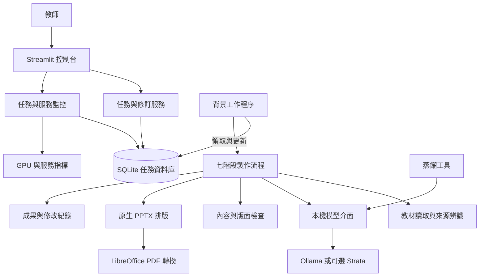
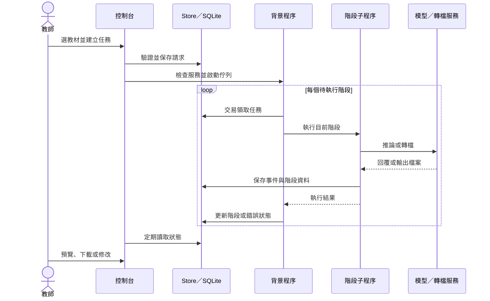
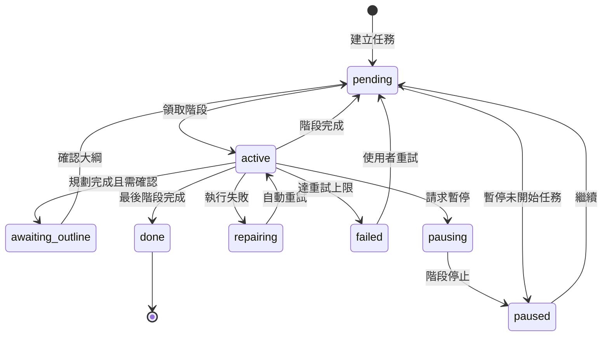

# 教材簡報工作室 · Teaching AI

**在自己的 Windows 電腦上，把課本單元做成可編輯的教學簡報。**

教材簡報工作室整合主教材讀取、教學規劃、本機模型編寫、內容審核、PowerPoint 排版、PDF 預覽與成果管理。教師可以在同一個控制台建立教材、確認大綱、監控進度、下載成果，再進行人工修改或單頁重製。

程式以本機模型處理教材生成，並保存任務狀態、來源資料、模型呼叫與教材修改紀錄，方便追查生成問題、比較修訂內容及分析製作品質。

[下載最新版本](https://github.com/welwang/teaching-ai/releases/latest) · [v1.0.1 發布說明](https://github.com/welwang/teaching-ai/releases/tag/v1.0.1) · [問題回報](https://github.com/welwang/teaching-ai/issues)

> 本說明對應目前 `main` 分支。v1.0.1 的安裝包與標籤保留原始精簡版本，使用說明可從本頁與發布頁查看。模型權重、LibreOffice、個人教材庫與既有成果需要另行準備。

## 內容索引

- [用途與支援範圍](#用途與支援範圍)
- [主要功能](#主要功能)
- [安裝與首次使用](#安裝與首次使用)
- [日常操作](#日常操作)
- [監控資訊與介面設定](#監控資訊與介面設定)
- [專案架構](#專案架構)
- [七階段製作流程](#七階段製作流程)
- [任務狀態與恢復](#任務狀態與恢復)
- [資料結構與輸出檔案](#資料結構與輸出檔案)
- [設定與模型管理](#設定與模型管理)
- [品質檢查與修改紀錄](#品質檢查與修改紀錄)
- [蒸餾與可選服務](#蒸餾與可選服務)
- [維護與擴充](#維護與擴充)
- [常見問題](#常見問題)
- [版本與驗證](#版本與驗證)

## 用途與支援範圍

這套系統適合希望在本機製作教材、保留編輯能力，並掌握生成過程的教師。主要工作是把指定主教材轉換為具有教學安排的簡報草稿，搭配教師備註與可選學習單。

| 項目 | 目前支援 |
| --- | --- |
| 作業環境 | Windows x64，本機網頁控制台 |
| 年級 | 國小四、五、六年級；國中一、二、三年級 |
| 科目 | 國語、數學、英語 |
| 學期 | 上學期、下學期 |
| 難度 | 低難度、中難度、高難度、全部 |
| 簡報頁數 | 8～50 頁，預設 12 頁 |
| 教材來源 | 既有教材庫，或上傳 PDF、DOCX、Markdown、純文字 |
| 主要成果 | 可編輯 PPTX、PDF、教師備課稿 DOCX |
| 選用成果 | 學生學習單、學習單教師解答 DOCX |
| 控制台位址 | `http://127.0.0.1:8502/` |
| 預設本機模型服務 | Ollama，`http://127.0.0.1:11435` |

新安裝不附個人教材庫，可直接選擇「上傳檔案」。來源品質會影響結果，尤其是掃描頁、損壞的 PDF 字元映射及圖中題目；這些內容需要適用的辨識能力與教師核對。

## 主要功能

### 從來源建立教學安排

系統讀取主教材，保存來源與頁碼，再依單元、年級、科目、難度及頁數建立大綱。內建 18 組年級／科目配置，涵蓋先備檢核、示範、學生任務、難度差異、迷思、配圖及評量。

教學配置集中於 [teaching-prompts.json](assets/workflow-v2/teaching-prompts.json)。生成時選用相關配置，主教材仍決定本次的知識範圍。題目必要條件、文本線索、英文例句與完整算式優先於文字容量建議。

### 大綱確認與單次提示詞

可以啟用「先確認大綱」，讓系統在逐頁編寫前等待教師查看與調整。大綱確認會檢查頁數、來源引用與教學安排，再繼續任務。

使用者也可以查看、修改與下載本次教學提示詞。成功建立任務後，修改內容保存在該任務中；其他新任務從預設配置開始，不會覆寫系統的教學 JSON。同一任務重試會沿用已保存的提示詞。

### 教材與備課資料一起交付

PPTX 使用原生文字與圖形建立，可在 PowerPoint 中繼續編輯。學生畫面和教師備註分開，備課說明另整理為 Word 文件。

勾選學習單後，系統會嘗試另外製作學生版與教師解答版。學習單失敗會保存原因並顯示警示，實際交付項目以成果清單為準。

### 完成後繼續修改

教師可以查看逐頁預覽、修改文字與教師備註，或指定一頁重新生成。單頁重製建立新的修訂任務，保存來源任務與修改指令，並重用其他頁面與適用快取。

重新排版使用既有內容調整外觀。人工修改及重新排版仍需要正常的匯出與 PDF 轉換環境，讓下載檔案與預覽保持一致。

### 監控與追溯

控制台集中顯示完成度、階段節點、已執行時間、預估時間、GPU、服務與事件。教材卡片顯示累計製作時間；內容與版面變更另記錄前後差異，供日後分析。

## 安裝與首次使用

### 環境準備

| 元件 | 用途與準備方式 |
| --- | --- |
| Windows x64 | 目前啟動與安裝腳本的主要交付環境 |
| Python 3.12 | 首次啟動由腳本準備專案環境，必要時安裝官方簽署的 Python |
| Python 套件 | 依 [requirements.txt](requirements.txt) 安裝 |
| Ollama 與適用模型 | 執行本機推論；模型權重需要另外安裝 |
| LibreOffice | PPTX 轉 PDF 與逐頁預覽，需要另外配置 |
| 足夠記憶體與磁碟 | 依模型大小、量化、上下文及選用功能而變 |

目前配置曾在 RTX 5090 32 GB 顯存、約 64 GB 系統記憶體的環境使用。這是已使用的環境，並非通用最低規格或速度保證；換用模型與硬體後，需要實際驗收。

### 方式一：使用安裝包

1. 從 [Releases](https://github.com/welwang/teaching-ai/releases/latest) 下載安裝 ZIP 與 SHA-256 校驗檔。
2. 完整解壓縮，執行 `installer/Install-TeachingAI.cmd`。
3. 選擇專用安裝資料夾，避免磁碟根目錄、來源重疊與連結目錄。
4. 完成後執行 `Start-TeachingAI.cmd`。
5. 準備適用模型與 LibreOffice，並調整本機 `config.yaml`。

首次啟動會準備 Python 與依賴，必要時準備本機模型引擎，需要網路與磁碟空間。安裝包沒有模型權重，也不會附帶使用者教材、成果或私人設定。

例如核對 v1.0.1 的 ZIP：

```powershell
Get-FileHash .\TeachingAI-Installer-v1.0.1.zip -Algorithm SHA256
```

應與該版本發布頁及 `.sha256` 檔一致：

```text
ce219f7b7c890aca81740dca7d9fa4895e736010fc6aa75033c95346520fcb91
```

### 方式二：從原始碼啟動

在 PowerShell 執行：

```powershell
git clone https://github.com/welwang/teaching-ai.git
cd teaching-ai
Copy-Item config.example.yaml config.yaml
powershell.exe -NoProfile -ExecutionPolicy Bypass -File .\bootstrap.ps1 -NoLaunch
```

接著修改 `config.yaml`，讓 `preferred_model` 對應實際安裝的模型，準備 LibreOffice，再啟動：

```powershell
.\Start-TeachingAI.cmd
```

瀏覽器會開啟 `http://127.0.0.1:8502/`。更新現有專案時應保留自己的 `config.yaml`，不要再次直接覆蓋設定。

### 第一次驗收

先使用一份文字清晰的小單元，設定 8 頁，關閉額外圖片和學習單。確認七階段完成後，在「我的教材」下載 PPTX、PDF 與教師備課稿。

逐頁核對文字、題目、答案、來源及版面，再逐步啟用其他選項。若只有 PPTX 而預覽失敗，先檢查 LibreOffice；若模型找不到，先核對本專案模型服務與安裝清單。

## 日常操作

### 製作教材

1. 選擇教材庫單元，或上傳主教材。
2. 設定年級、科目、學期、難度與頁數。
3. 視需要調整本次教學提示詞，以及大綱、學習單與圖片選項。
4. 查看任務摘要，按「開始製作簡報」。
5. 若啟用大綱確認，完成規劃後開啟任務、確認大綱，再繼續。

### 查看與修改成果

「我的教材」提供搜尋與狀態篩選，卡片可下載簡報，也可開啟預覽、檔案、品質及修改資訊。需要調整一頁時，可以人工修改或單頁重製，修改後再查看新預覽與品質提示。

移除教材會先放入本機回收資料區。控制台目前沒有完整的回收區瀏覽與還原介面，需保留資料時應另外備份。

### 暫停與關閉

| 操作 | 行為 |
| --- | --- |
| 暫停指定任務 | 執行中的任務先進入 `pausing`，背景程序停止階段後轉為 `paused` |
| 暫停佇列 | 保存暫停標記，讓目前階段完成後不再領取後續階段 |
| 繼續任務 | 恢復待執行狀態，檢查所需模型服務並啟動工作程序 |
| 從失敗處重試 | 重設失敗狀態，從已保存的階段與可用資料繼續 |
| 關閉系統 | 執行 `關閉教材AI.cmd`，處理本系統管理的背景程序與網頁服務 |

暫停、繼續與移除發生在階段切換時，需要由背景程序協調，因此畫面可能短暫顯示處理中。重新啟動後可繼續已暫停的任務。

## 監控資訊與介面設定

### 三個分頁

| 分頁 | 工作範圍 |
| --- | --- |
| 製作教材 | 來源與任務設定、單次提示詞、大綱與開始操作 |
| 我的教材 | 成果、預覽、品質、修改、搜尋、下載與任務管理 |
| 系統與紀錄 | 服務、診斷、運行資訊與問題定位 |

### 指標定義

| 指標 | 讀法 |
| --- | --- |
| 完成度 | 七階段的加權流程完成度，執行中最多 99%，完成後 100% |
| 階段節點 | 目前位於來源、規劃、編寫、審核、排版、預覽或發布 |
| T+／已執行時間 | 由已記錄執行區間估算的累計時間 |
| 預估時間 | 有足夠資料時的估計，受模型、頁數與硬體影響 |
| GPU | 本機 `nvidia-smi` 提供的使用率與顯存；無法取得時顯示未知 |
| 服務與事件 | 模型、相關服務健康資訊與目前階段訊息 |
| 製作總時長 | 教材卡片的已記錄執行時間，與排隊及大綱等待分開 |

目前階段權重依序為 **3、12、40、25、8、5、7**。編寫與審核較耗時，完成度增加 10% 不代表剩餘時間固定減少 10%。排版、來源讀取與檔案輸出時 GPU 下降也可能是正常現象。

監控使用 Streamlit fragment 更新，預設每秒刷新；教材清單另觀察狀態變化，避免每次重繪全部表單。GPU 查詢有短期快取，減少重複啟動外部工具。

### 配色與可讀性

介面採克制的任務控制室風格：大數字、小標籤、細線、留白、對齊與柔和圓角。配色以背景與文字為主，狀態使用綠、黃／棕與紅等顏色。

| 選單名稱 | 風格名稱 |
| --- | --- |
| 白色 | 航太白 |
| 任務控制（深色） | 軌道黑 |
| 米色 | 暖紙米 |
| 淡綠 | 霧森綠 |
| 暮紫灰 | 暮紫灰 |

字級提供小、中、大、特大，基準文字至少 16 像素，主要點擊區以至少 44 像素為設計基準。進度條與節點具有平順過渡；「減少動畫」停用動畫效果，監控仍繼續更新。介面偏好保存在本機 `ui-prefs.json`。

## 專案架構

### 架構總覽

系統由控制台、應用服務、任務儲存、背景工作程序、教材流程與本機服務組成。Streamlit 負責互動與顯示，SQLite 保存任務狀態，背景程序以獨立階段執行生成工作，成果保存在檔案系統。



### 模組責任

| 層次 | 主要檔案 | 責任 |
| --- | --- | --- |
| 啟動與關閉 | `bootstrap.ps1`、`launch_v2.py`、`shutdown.py` | 環境準備、本機服務、瀏覽器與背景程序生命週期 |
| 控制台 | `app_v2.py`、`panel.py` | 教材表單、成果操作與系統分頁 |
| 外觀與視圖 | `panel_style.py`、`panel_view.py`、`animations.py`、`brand.py` | 配色、資訊排列、動畫與品牌資產 |
| 應用服務 | `service.py`、`page_edit.py`、`restyle.py` | 大綱確認、成果查詢、修訂、人工編輯及重新排版 |
| 任務儲存 | `store.py` | SQLite、領取交易、狀態、事件、回收資料與原子寫入 |
| 背景執行 | `worker.py` | 程序鎖、階段子程序、逾時、暫停、重試及恢復 |
| 流程協調 | `pipeline.py` | 七階段處理、各模組串接與成果整理 |
| 教材與教學配置 | `library.py`、`source_reader.py`、`curriculum_prompts.py`、`pedagogy.py`、`age_bands.py` | 教材庫、來源辨識與年級／科目規則 |
| 合約與模型政策 | `contracts.py`、`model_policy.py` | 資料驗證、大綱與頁面規格、固定模型與上下文設定 |
| 推論與資源 | `model.py`、`engine.py`、`strata.py`、`concurrency.py` | 模型呼叫、服務管理、資源鎖與並行回退 |
| 品質檢查 | `qa.py`、`originality.py`、`text_safety.py`、`deck_check.py`、`visual_qa.py` | 內容、來源、算式、文字安全及版面檢查 |
| 簡報排版 | `renderer.py`、`slide_layouts.py`、`textfit.py`、`template_builder.py`、`template_design.py`、`template_styles.py` | 原生 PowerPoint 元件、風格、幾何配置與文字適配 |
| 圖片與圖解 | `images.py`、`local_images.py`、`forge_boot.py`、`image_fallback.py`、`visuals.py`、`visual_draw.py` | 可選圖片服務、來源紀錄、原生教學圖形與回退 |
| 轉檔與完成處理 | `office.py`、`final_optimizer.py`、`worksheet.py` | PDF、最後內容優化、教師文件與學習單 |
| 監控 | `console_state.py`、`monitoring.py`、`monitor_report.py`、`health.py` | 完成度、時間、GPU、模型使用與診斷 |
| 追溯 | `change_log.py`、`runlog.py`、`page_policy.py`、`speedup.py` | 修改紀錄、運行事件、快取政策與重用 |

表中的 Python 模組都位於 `workflow_v2/`，啟動與關閉檔案位於根目錄。`template_*` 是目前程式產生排版的模組名稱，不代表外部預製模板套件。

### 一次任務如何執行



若需要教師確認大綱，迴圈會在編寫前等待操作。實際模型設定在提交與領取任務時會依管理政策綁定；保存的請求不是所有欄位永遠不變的快照。

### 目錄配置

```text
teaching-ai/
├─ README.md                         專案說明與架構
├─ Start-TeachingAI.cmd               正式啟動入口
├─ 開啟教材AI.cmd / 關閉教材AI.cmd     中文啟動與關閉入口
├─ bootstrap.ps1                     環境準備
├─ launch_v2.py / shutdown.py         程序管理
├─ app_v2.py                         Streamlit 入口
├─ config.example.yaml               設定範本
├─ requirements.txt                  應用依賴
├─ .streamlit/config.toml             Streamlit 外觀設定
├─ workflow_v2/                      教材、任務、監控與修改模組
│  └─ schemas/                       JSON 合約資料
├─ assets/
│  ├─ brand/                         標誌與圖示
│  └─ workflow-v2/
│     ├─ teaching-prompts.json        預設教學配置
│     └─ final-optimization-rules.txt  最後優化規則
├─ installer/                        安裝入口與腳本
└─ distill/                          蒐集、挑選、訓練與比較工具
```

`workflow_v2/contracts.py` 定義執行時驗證規格，並可依要求的頁數與來源頁碼建立動態合約。`schemas/` 保存對應類型的 JSON 合約資料。修改資料結構時需要一起檢查模型提示、驗證、儲存、排版與介面使用的位置。

## 七階段製作流程


| 階段 | 工作與資料 |
| --- | --- |
| `source` | 讀取來源、處理需要辨識的 PDF 頁面、區分學生內容與教師背景，保存來源及雜湊 |
| `plan` | 分析來源、選取教學安排、建立大綱，必要時等待教師確認 |
| `write` | 逐頁生成標題、內容、任務、教師備註與相關圖解規格 |
| `review` | 檢查格式與內容，進行有限次修正，保存仍需教師確認的警示 |
| `render` | 產生原生 PPTX，安排文字、圖形與可選圖片，檢查版面 |
| `preview` | 使用 LibreOffice 轉成 PDF，再以 PyMuPDF 產生逐頁預覽 |
| `publish` | 進行最後內容優化、必要時更新預覽，產生備課稿與選用學習單，整理成果清單 |

階段資料保存於任務資料夾。來源、教學政策或頁面指紋改變時，相關快取會重新判斷；不能把「有舊檔案」直接當成「可以重用」。背景程序也會檢查主教材是否變更，必要時從來源重整任務。

## 任務狀態與恢復

### 狀態概要



圖中的 `active` 是執行中狀態的合稱，實際資料庫使用 `running`、`reviewing` 與 `rendering`。修訂複製期間另有 `staging`，移除處理期間有 `removing`；上圖聚焦主要流程。

### 避免重複執行與失敗卡住

- `Store.claim()` 使用 `BEGIN IMMEDIATE` 與目前任務資訊，避免同時領取第二份教材。
- 背景工作程序持有 `worker.lock`，維持單一調度程序。
- 每個階段在子程序執行，具有依階段與頁數調整的時間限制，可處理逾時或暫停。
- JSON 使用暫存檔與 `os.replace` 寫入，降低半寫入檔案的風險；Windows 檔案鎖定有有限次重試。
- 階段失敗先轉為 `repairing`，目前同一階段最多三次失敗後標記 `failed`。模型格式修正另有自己的有限嘗試，不等同階段重試次數。
- 工作程序取得鎖後會恢復未完成狀態，再從保存的階段與可用資料繼續。

這些設計保留恢復線索，仍需核對原始來源、模型、設定與工具。更換模型或更新程式後，舊快取是否可用由目前政策與指紋決定。

## 資料結構與輸出檔案

### SQLite 任務資料庫

資料庫位置：`data/workflow-v2/jobs.sqlite`。

| 資料表 | 主要欄位 | 用途 |
| --- | --- | --- |
| `jobs` | `id`、`request`、`status`、`stage`、`attempts`、`error`、`created`、`updated` | 請求、目前階段、重試與狀態 |
| `events` | `id`、`job`、`stage`、`message`、`created` | 任務事件與時間線 |
| `queue_state` | `key`、`value` | 目前任務等佇列協調資訊 |

`request` 是 JSON 文字；資料庫啟用 WAL。大篇幅模型回覆與成果放在檔案系統，資料庫主要保存調度與狀態資料。

### 執行後建立的資料

```text
teaching-ai/
├─ config.yaml                       本機管理設定
├─ .venv/                            應用 Python 環境
├─ runtime/                          本機執行工具
├─ models/ollama/                     本專案 Ollama 模型
├─ logs/                             啟動與系統日誌
└─ data/
   ├─ workflow-v2/
   │  ├─ jobs.sqlite                 任務資料庫
   │  ├─ uploads/                    上傳主教材
   │  ├─ jobs/<job_id>/              每份教材的資料與成果
   │  ├─ deck-changes/YYYY-MM.jsonl   月份修改紀錄
   │  ├─ trash/                      移除任務的資料
   │  └─ ui-prefs.json               外觀偏好
   └─ distill/                       蒸餾資料、權重與比較結果
```

### 單份教材的代表性檔案

| 路徑或檔名 | 用途 |
| --- | --- |
| `source.json`、`analysis.json` | 來源內容與分析 |
| `plan.json` | 教學大綱 |
| `slides/001.json` 等 | 逐頁原稿 |
| `reviews/`、`page-policies/` | 審核與頁面重用政策 |
| `calls/` | 模型呼叫資料 |
| `teaching-profile.json`、`teaching-prompt.md` | 本次教學配置與提示詞追溯 |
| `reviewed-deck.json`、`rendered-deck.json`、`final-optimized-deck.json` | 各階段教材內容 |
| `教材.pptx`、`教材.pdf`、`previews/` | 簡報、PDF 與逐頁預覽 |
| `教師備課稿.docx` | 教師文件 |
| `學生學習單.docx`、`學習單教師解答.docx` | 選用學習單成果 |
| `qa-report.json`、`quality-warnings.json`、`layout-warnings.json` | 內容與版面品質線索 |
| `deck-validation.json`、`visual-qa.json`、`final-optimization.json` | 簡報、圖像與最後優化報告 |
| `image-sources.json`、`visual-assets.json` | 圖片來源與使用資訊 |
| `changes.jsonl`、`regenerate.json` | 修改紀錄與修訂關係 |
| `result.json` | 最終成果清單、品質與選用功能狀態 |

檔案會依任務選項與實際結果建立，並非每次都有所有項目。發布階段另複製成含教材資訊的下載檔名；控制台依 `result.json` 的成果清單提供檔案。

`teaching-prompt.md` 是任務產生的追溯資料，與專案說明文件用途不同。模型回覆與修改快照可能包含教材內容，分享日誌前應先移除私人資料。

## 設定與模型管理

### 設定檔

[config.example.yaml](config.example.yaml) 是可公開的範本，`config.yaml` 是本機使用設定，不納入 Git。啟動時如果沒有本機設定，會從範本建立。

| 設定 | 範本值 | 意義 |
| --- | --- | --- |
| `ollama_url` | `http://127.0.0.1:11435` | 本機 Ollama 服務 |
| `preferred_model` | `qwen3.8:27b-q4_K_M` | 本專案配置的模型標籤，需與實際安裝一致 |
| `generation_architecture` | `dense_27b` | 生成流程的架構設定 |
| `model_selection` | `fixed` | 由管理設定綁定模型 |
| `generation_context` | `32768` | 允許 `8192`、`16384` 或 `32768` |
| `ollama_parallel` | `1` | 模型服務並行槽位設定，目前限制為 1～2 |
| `write_concurrency` | `1` | 逐頁編寫並行設定，目前限制為 1～2 |
| `parallel_min_total_vram_mb` | `28000` | 並行所需總顯存門檻 |
| `parallel_min_free_vram_mb` | `20000` | 並行所需可用顯存門檻 |
| `image_generation_enabled` | `false` | 是否啟用可選本機生圖服務 |
| `image_generation_url` | `http://127.0.0.1:7860/sdapi/v1/txt2img` | 相容圖片服務端點 |
| `image_priority_unload_resident_models` | `true` | 圖片處理的模型資源協調選項 |
| `console_refresh_seconds` | `1` | 監控更新間隔，允許 1～60 秒 |
| `slide_logo` | `off` | 可用 `cover` 在封面加入小標誌 |
| `strata_url`、`strata_config` | 範本中的本機位址與路徑 | 可選 Strata 服務設定 |
| `distilled_model` | 未設定 | 指定已匯出的文字蒸餾模型 |

本機生圖自動啟動還需要依實際服務設定 `image_generation_python` 與 `image_generation_launcher`，安裝包不提供該服務的模型權重。

### 模型選擇與位置

`qwen3.8:27b-q4_K_M` 是本專案使用的標籤，不代表安裝包已附模型，也不保證可從公開模型庫直接下載。請準備適用模型，將實際名稱寫入設定；掃描頁與圖像檢查還需要對應能力。

固定模型模式下，任務提交與領取時會綁定管理設定的模型。設定了 `distilled_model` 時，文字生成選用蒸餾模型；含圖片的呼叫會依模型政策回到基礎模型。

本專案管理的 Ollama 使用 11435 埠與 `models/ollama/`，與其他 Ollama 實例的預設資料位置可能不同。系統啟動後可以查詢：

```powershell
Invoke-RestMethod http://127.0.0.1:11435/api/tags
```

Ollama 推論端點在程式內限制為本機 HTTP 位址，不接受遠端主機、憑證型網址、查詢字串或額外路徑。預設逐頁並行為 1，顯存條件不足或出現容量錯誤時會保存回退狀態。

### 網路使用範圍

教材上傳與任務資料保存在本機，模型生成透過本機服務進行。首次安裝、模型準備、開放授權圖片搜尋、可選服務下載與訓練依賴會使用網路。

準備好所有環境並停用線上圖片後，可以減少製作時的外部網路需求。控制台綁定本機位址，目前沒有公開網路多使用者的身份驗證，也尚未串接跨主機客服 App。

## 品質檢查與修改紀錄

### 內容與版面檢查

品質流程包含 JSON 合約、來源引用、部分算式與題目條件、語言與學生／教師文字分離、原文重複、圖解規格、文字容量及版面等檢查。模型修正有次數限制，避免無止境重寫。

無法可靠完成的頁面會保存待確認資訊，必要時產生提示頁，提醒教師核對原教材與重做。檔案生成完成仍是教材草稿，需要教師確認知識、題意、算式、解答、來源、圖片授權與教學適切性。

### 修改歷史

`change_log.py` 記錄大綱、逐頁內容、審核、排版及最後優化等資料的前後變更，並可記錄使用者修改提示詞與修訂操作。

| 紀錄欄位 | 用途 |
| --- | --- |
| `change_id`、`time`、`job_id` | 唯一變更、時間與教材 |
| `actor`、`action`、`stage`、`reason` | 操作者、操作類型、階段與原因 |
| `page`、`artifact` | 對應頁面與資料檔 |
| `model`、`teaching_policy_fingerprint` | 模型與教學配置指紋 |
| `before_sha256`、`after_sha256` | 變更前後內容雜湊 |
| `before`、`after`、`changes` | 前後快照與 JSON Pointer 欄位差異 |
| `parent_job` 等修訂欄位 | 有修訂來源時連結到原任務 |

每份任務的 `changes.jsonl` 與月份彙總 `deck-changes/YYYY-MM.jsonl` 方便分別查看單份教材和跨任務趨勢。沒有內容變動時不重複記錄；紀錄寫入失敗會另留運行事件。

運行日誌由 `runlog.py` 管理，系統 JSONL 路徑為 `logs/workflow-v2.jsonl`，大檔有輪替機制。它主要記錄運作中繼資訊；教材修改快照、模型請求與回覆有各自的資料位置。

## 蒸餾與可選服務

### 蒸餾流程

`distill/` 是獨立的模型改進工具，可收集生成請求與回覆，使用品質規則挑選資料，再訓練、匯出與比較。一般教材製作不必先完成蒸餾。


| 入口 | 工作 |
| --- | --- |
| `1-蒐集.cmd` | 收集模型請求與回覆 |
| `2-挑選.cmd` | 品質評分、重新取樣與挑選 |
| `3-建立資料集.cmd` | 整理訓練與驗證資料 |
| `4-安裝訓練環境.cmd` | 準備獨立的訓練環境 |
| `5-訓練.cmd` | 執行訓練，可先加 `--check` |
| `6-匯出到Ollama.cmd` | 匯出與建立模型 |
| `7-比較新舊.cmd` | 使用保留資料比較 |
| `0-全自動.cmd` | 依序協調上述流程，依比較結果決定採用 |

另有完成後關機的入口，使用前應理解其關機行為。訓練會使用額外權重、套件、磁碟與 GPU，並可能停止教材服務讓出資源。耗時與效果需要以實際資料及比較結果判斷。

### 可選 Strata 與本機生圖

專案保留 `Install-Strata.cmd`、`install_strata.py` 與 Strata 模型介面，以及 Forge／相容本機圖片服務的整合。這些功能需要額外服務、設定與模型，不能由安裝 ZIP 的存在推定已可使用。

圖片搜尋與本機生圖可依任務選項啟用。來源、授權及使用狀態會保存在任務資料；無法取得圖片時，請查看成果警示與實際版面。

## 維護與擴充

### 更新與備份

更新前先關閉系統，備份 `data/`、`config.yaml` 與需要保留的模型。資料庫使用 WAL，應關閉後再完整複製資料區，避免只複製 `.sqlite` 而漏掉待合併的變更。

安裝程式複製新檔案，不會自動清除舊檔或提供資料遷移。使用獨立資料夾驗收新版，可降低舊依賴與新程式混用的問題。

### 修改功能時的檢查位置

| 修改內容 | 需要一起檢查 |
| --- | --- |
| 新增教材選項 | `panel.py`、`contracts.py`、`service.py`、`pipeline.py` 與結果呈現 |
| 調整教學配置 | 教學 JSON、`curriculum_prompts.py`、提示詞與相關快取指紋 |
| 新增模型後端 | 模型政策、模型介面、健康檢查、worker 啟動與使用統計 |
| 調整排版 | renderer、slide layouts、textfit、內容／版面檢查與 PDF 預覽 |
| 新增監控指標 | monitoring、console state、panel view，以及未知狀態的呈現 |
| 改變任務狀態 | Store、worker、service、控制台與中斷／恢復處理 |
| 修改記錄格式 | change log、歷史讀取、版本欄位與既有資料相容性 |

## 常見問題

| 情況 | 建議處理 |
| --- | --- |
| 首次啟動停在安裝 | 查看啟動訊息與 `logs/`，檢查網路、磁碟及 Windows 應用控制策略 |
| 教材庫沒有內容 | 新安裝不含私人教材庫，可使用上傳檔案 |
| 找不到模型 | 核對 `preferred_model`、11435 服務與 `/api/tags` |
| 模型服務無法啟動 | 檢查 Ollama 路徑、埠佔用與 `logs/ollama.err.log` |
| PDF 文字辨識不完整 | 核對主教材、頁面清晰度與模型的圖片辨識能力 |
| 等待大綱而沒有前進 | 開啟任務查看並確認大綱 |
| 逐頁生成很慢 | 查看模型、上下文、頁數、顯存，以及圖片服務或訓練是否競爭資源 |
| 卡在 PDF／預覽 | 確認 LibreOffice、檔案鎖定與該階段日誌 |
| 某頁標示待教師確認 | 查看品質及備註，核對來源後人工修改或重製 |
| 學習單未提供 | 查看是否勾選及 `worksheet_status`、錯誤訊息與成果警示 |
| GPU 顯示未知 | 檢查驅動與 `nvidia-smi`；監控讀取與模型執行應分別確認 |
| 更新後出現舊說明檔 | 安裝程式不自動刪除舊檔，需另外整理既有安裝目錄 |

問題請提交到 [Issues](https://github.com/welwang/teaching-ai/issues)，附版本、Windows 與 GPU 環境、發生階段、錯誤訊息，以及去除私人教材內容後的相關日誌。

## 版本與驗證

| 版本 | 內容 |
| --- | --- |
| [v1.0.0](https://github.com/welwang/teaching-ai/releases/tag/v1.0.0) | 第一個公開正式版本，保留原始程式、文件與測試快照 |
| [v1.0.1](https://github.com/welwang/teaching-ai/releases/tag/v1.0.1) | 精簡執行版本，移除非執行文件、測試與舊工具，保留全部監控及教材功能 |
| 目前 `main` | 在 v1.0.1 基礎上提供本份詳細 README；安裝包與既有標籤保持原樣 |

v1.0.1 清理前，534 項回歸測試全部通過。清理後，已從安裝包載入 67 個應用與蒸餾模組、18 組教學配置和三個控制台分頁，介面沒有執行例外；另核對安裝 ZIP、必要檔案、可攜設定、公開下載與 SHA-256。

測試檔已從目前精簡分支移除，可由 [v1.0.0 測試快照](https://github.com/welwang/teaching-ai/tree/v1.0.0/tests) 查看歷史回歸內容。這些結果不代表每種主機都已完成全新安裝，也不保證每份教材無誤。新主機仍需執行首次驗收，教師使用前仍需逐頁確認。
