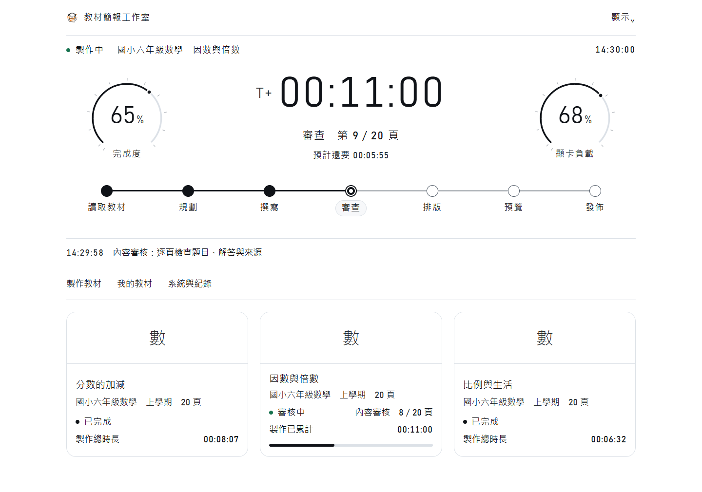
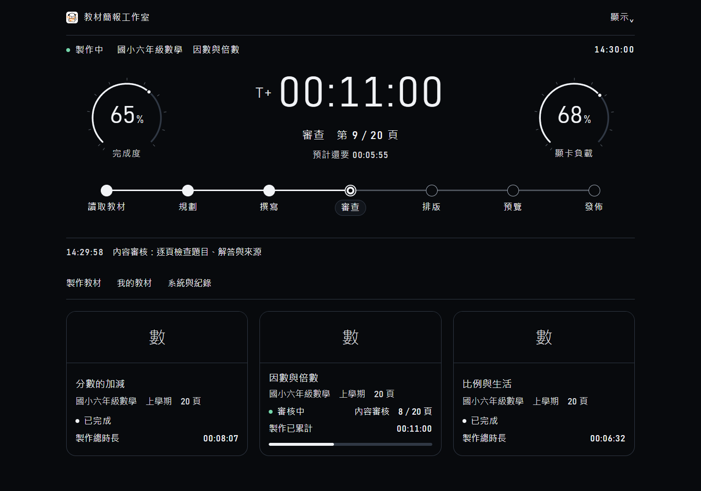
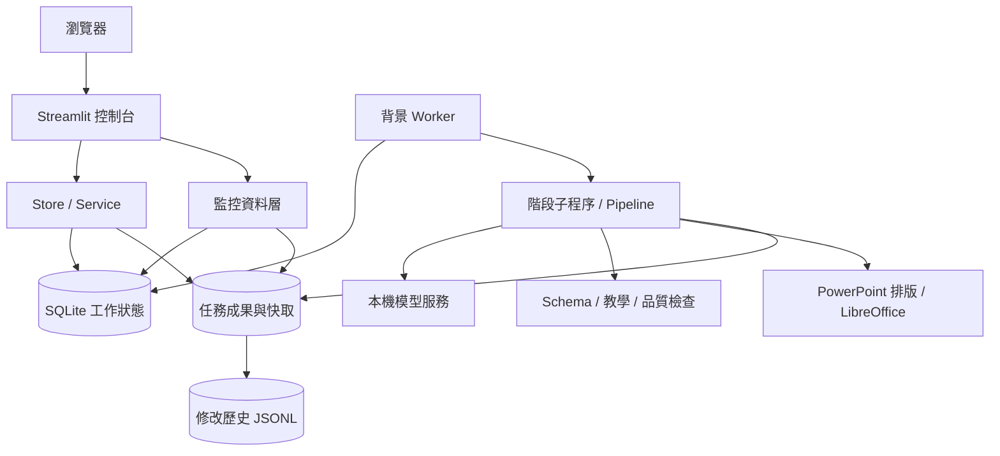

# 教材簡報工作室 · Teaching AI

將課本單元整理成可以編輯、預覽與修訂的教學簡報。系統在 Windows 本機執行，串接本地模型，完成教材讀取、教學規劃、逐頁編寫、內容審核、排版與成果輸出；教師可以確認大綱、調整單次教學提示詞，並追蹤每份教材的製作與修改記錄。

[下載正式版本](https://github.com/welwang/teaching-ai/releases/latest) · [專案架構](docs/專案架構.md) · [安裝部署](docs/安裝與部署.md) · [操作指南](操作說明-任務控制台.md) · [提出問題](https://github.com/welwang/teaching-ai/issues)



上圖使用展示資料，呈現正式監控元件的版面與資訊層級。

<details>
<summary>軌道黑主題預覽</summary>



</details>

## 專案目標

教材製作需要同時處理教學順序、學生程度、題目與解答、畫面可讀性，以及老師實際授課時要說的內容。本專案將這些工作分成可驗證的階段，保存中間成果，讓教師從一份主教材出發，取得簡報、備課稿與可選的學習單。

生成完成後，仍可查看來源頁碼、品質警示與逐頁預覽，再以人工編輯或單頁重製調整內容。原稿、修訂關係和修改前後資料都有獨立記錄，方便後續分析常見錯誤和改進方向。

## 支援範圍

| 項目 | 目前支援 |
| --- | --- |
| 系統 | Windows x64；啟動與安裝腳本採 Windows 原生流程 |
| 介面 | 繁體中文；桌面與窄螢幕排版 |
| 年級 | 國小四、五、六年級；國中一、二、三年級 |
| 科目 | 國語、數學、英語 |
| 教材來源 | PDF、DOCX、Markdown、TXT；既有本機教材庫可選用 |
| 簡報頁數 | 8～50 頁，預設 12 頁 |
| 模型 | 本機 Ollama；預設模型名稱由設定檔指定，另有 Strata 後端與蒸餾工具 |
| 輸出 | PPTX、PDF、PNG 預覽、教師備課稿 DOCX；可選學生學習單與教師解答 |

安裝包不附模型權重、教材庫、來源教材或既有成果。新安裝沒有教材庫時，直接使用「上傳檔案」。

## 主要功能

### 教材轉換與教學規劃

- 從來源文件擷取文字、保留頁碼，將長教材分段整理。
- 依年級與科目載入教學提示詞，規劃學習目標、頁序、活動與難度。
- 逐頁區分導入、概念、示範、練習、檢核與總結，產生投影文字和教師備註。
- 可先確認大綱，修改頁序、主題、教學階段和引用頁碼後再繼續。
- 教學提示詞可修改，但只存入本次任務；提交成功後編輯區還原系統預設。

### 內容與版面檢查

- JSON Schema 驗證模型輸出，限制欄位、版型和引用範圍。
- 離線檢查算式、題目條件、答案一致性、教學適配與殘留文字。
- 檢查與來源教材的重複內容，將教材用於教學改寫與來源追溯。
- 模型修復與階段重試有上限；需教師補寫的頁面會明確標示。
- 排版使用原生 PowerPoint 圖形與文字框，圖解和文字可繼續編輯。
- 匯出後檢查溢出、重疊、空白頁和文字對比，保存修復與剩餘問題。
- 最後優化保留原始版面，記錄接受或撤回的文字調整。

### 任務監控與教材管理

- 七階段進度線、製作計時、完成度、顯卡負載與目前任務。
- 佇列暫停、單一任務暫停續作、失敗處重試與生成服務控制。
- 「我的教材」提供搜尋、狀態篩選、預覽、下載與製作總時長。
- 製作總時長累計記錄到的執行區間，排隊與大綱確認等待不計入。
- 遙測詳情包含生成速度、顯存、詞元、服務狀態與事件。
- 五種配色、四種字級及減少動畫設定會保存於本機。
- 單頁重製建立修訂任務；人工文字編輯與重新排版保留操作記錄。

### 修改分析與模型改進

- 記錄大綱、頁面、版面及最終優化的修改前後內容。
- 以 JSON Pointer 保存新增、移除和替換的欄位差異。
- 依任務、操作者、模型、階段、原因和修訂關係追蹤修改。
- 月份紀錄與任務紀錄獨立保存，清除運行 log 不會清除修改歷史。
- `distill/` 提供蒐集、候選挑選、資料集建立、QLoRA 訓練、匯出與比較工具，使用獨立訓練環境。

## 快速開始

### 方式一：下載安裝包

1. 從 [Releases](https://github.com/welwang/teaching-ai/releases) 下載 `TeachingAI-Installer-v1.0.0.zip`。
2. 完整解壓縮，執行 `installer/Install-TeachingAI.cmd`，選擇專用安裝資料夾。
3. 執行安裝資料夾中的 `Start-TeachingAI.cmd`。首次啟動會準備 Python 虛擬環境、依賴與必要的模型引擎。
4. 安裝 LibreOffice，並另外準備本機模型；模型名稱需與 `config.yaml` 一致。
5. 開啟 `http://127.0.0.1:8502/`，在「系統與紀錄」檢查服務，然後上傳教材。

### 方式二：使用原始碼

```powershell
git clone https://github.com/welwang/teaching-ai.git
cd teaching-ai
Copy-Item config.example.yaml config.yaml
powershell.exe -NoProfile -ExecutionPolicy Bypass -File .\bootstrap.ps1 -NoLaunch
.\Start-TeachingAI.cmd
```

`bootstrap.ps1` 在設定檔不存在時會複製預設範本。原有的 `config.yaml` 會保留，更新程式不會覆寫個別主機設定。

首次安裝流程、模型匯入與常見錯誤見 [安裝與部署](docs/安裝與部署.md)。

## 系統需求

| 元件 | 用途 |
| --- | --- |
| Windows x64 | 安裝、啟動、服務管理與本機轉檔 |
| Python 3.12 | 控制台與生成流程；由 bootstrap 準備隔離環境 |
| Ollama 與可用模型 | 本機教材解析、規劃、編寫、審核與修復 |
| LibreOffice | PPTX 轉 PDF，再產生 PNG 預覽 |
| 模型所需的記憶體、顯存與磁碟 | 依實際模型、上下文及是否生圖而定 |
| 網路 | 首次下載依賴；啟用線上圖片時進行搜尋與下載 |

既有驗證以 RTX 5090 32 GB 顯存與約 64 GB 系統記憶體環境為主。這是驗證環境，專案尚未建立涵蓋各硬體組合的最低規格表。預設模型名稱為 `qwen3.8:27b-q4_K_M`，是設定中的本機標籤，發布包不提供該模型權重。

## 製作流程


每個階段有獨立處理函式、成果檔與檢查點。工作程序在背景執行，介面讀取任務狀態；暫停、失敗或重新啟動後，優先使用已完成且仍符合來源與規則的資料。

## 專案架構



| 層級 | 核心模組 | 責任 |
| --- | --- | --- |
| 介面 | `panel.py`、`panel_view.py`、`panel_style.py` | 表單、卡片、監控、配色與操作 |
| 應用服務 | `service.py`、`store.py` | 輸入驗證、任務狀態、大綱確認、成果和修訂 |
| 調度 | `worker.py`、`engine.py`、`concurrency.py` | 階段執行、服務管理、鎖與資源協調 |
| 生成 | `pipeline.py`、`model.py`、`curriculum_prompts.py` | 來源脈絡、提示詞、結構化回覆與重試 |
| 品質 | `qa.py`、`originality.py`、`deck_check.py`、`visual_qa.py` | 內容、原創表達、整份簡報及畫面檢查 |
| 排版 | `renderer.py`、`slide_layouts.py`、`visual_draw.py`、`office.py` | 原生可編輯投影片、轉檔與預覽 |
| 觀測 | `monitoring.py`、`console_state.py`、`monitor_report.py` | 狀態、耗時、詞元、服務及事件整理 |
| 追蹤 | `change_log.py`、`runlog.py`、`page_edit.py` | 執行紀錄、修改差異和人工編輯 |
| 模型改進 | `distill/` | 蒐集、評分、訓練與比較 |

詳細的資料模型、狀態機、鎖、快取與擴充方式見 [專案架構](docs/專案架構.md)。

## 檔案與資料位置

```text
teaching-ai/
├─ app_v2.py                  網頁入口
├─ launch_v2.py               本機啟動
├─ bootstrap.ps1             安裝與環境初始化
├─ config.example.yaml       可攜設定範本
├─ workflow_v2/              教材製作與控制台
├─ assets/                   品牌、教學提示詞與規則
├─ distill/                  模型蒸餾工具
├─ tests/                    功能與回歸測試
├─ docs/                     架構、部署與設計文件
├─ installer/                Windows 安裝介面
├─ data/                     本機任務、快取與修改歷史
├─ models/                   本機模型權重
├─ runtime/                  本機依賴執行工具
└─ logs/                     服務與運行紀錄
```

一份任務的成果位於 `data/workflow-v2/jobs/<任務ID>/`，包括來源、解析、大綱、逐頁 JSON、品質報告、簡報、備課稿與預覽。公開儲存庫與安裝包只包含程式、預設規則、素材和文件；`data/`、`models/`、`runtime/`、`logs/`、個人設定、憑證與歷史備份均排除。

## 設定與本機服務

| 設定 / 位址 | 預設 | 說明 |
| --- | --- | --- |
| 控制台 | `127.0.0.1:8502` | 本機 Streamlit 網頁 |
| `ollama_url` | `http://127.0.0.1:11435` | 專案管理的本機模型服務 |
| `preferred_model` | `qwen3.8:27b-q4_K_M` | 管理員指定的已安裝模型名稱 |
| `generation_context` | `32768` | 固定上下文；程式接受 8192、16384 或 32768 |
| `ollama_parallel` / `write_concurrency` | `1` / `1` | 預設逐份、逐頁執行 |
| `console_refresh_seconds` | `1` | 即時監控區更新間隔 |
| `image_generation_enabled` | `false` | 安裝包預設停用本機生圖 |
| `image_generation_url` | 本機 `7860` | 選用的 SD WebUI 相容服務 |
| `distilled_model` | 未設定 | 選用的蒸餾文字模型 |

設定詳解和檢查指令見 [安裝與部署](docs/安裝與部署.md)。

## 資料處理與連線範圍

教材文字與模型推論交給本機服務；模型端點限制為 loopback HTTP。系統沒有把教材上傳到雲端模型的預設路徑。

啟用「上網搜尋開放授權圖片」時，會對外傳送搜尋關鍵字，查詢 Wikimedia Commons 或 Openverse 並下載符合程式授權篩選的圖片。首次安裝和蒸餾環境建立也會下載依賴或權重。若不使用網路圖片，可在任務選項關閉。

修改紀錄含完整的修改前後內容，模型回覆和來源也保存於本機任務目錄。分享成果或分析資料時，應按實際需要選擇檔案。

## 開發、測試與發版

以下命令使用完整原始碼儲存庫。Windows 安裝包不包含 `tests/` 或打包腳本；開發與測試請先 clone 專案。

```powershell
# 完整回歸測試
.\.venv\Scripts\python.exe -m unittest discover -s tests -p 'test_*.py'

# 控制台與品質檢查相關測試
.\.venv\Scripts\python.exe -m unittest tests.test_panel tests.test_qa tests.test_change_log

# 本機服務檢查
.\.venv\Scripts\python.exe -m workflow_v2.health

# 建立帶版本資訊的安裝包
.\build_installer.ps1 -Version 1.0.0 -Output .\dist\TeachingAI-Installer-v1.0.0.zip
```

v1.0.0 發布前的完整回歸基準為 534 項測試。測試通過代表已覆蓋的程式行為符合預期；新主機仍需驗證本機模型、LibreOffice 和實際教材工作。安裝包附 SHA-256 校驗檔與套件清單。

## 文件索引

| 文件 | 適合閱讀的內容 |
| --- | --- |
| [操作指南](操作說明-任務控制台.md) | 製作教材、監控、下載、編輯、暫停與續作 |
| [安裝與部署](docs/安裝與部署.md) | 新主機安裝、模型準備、設定、更新和排錯 |
| [專案架構](docs/專案架構.md) | 模組、資料模型、階段、鎖、快取和修訂流程 |
| [系統說明](第二代系統說明.md) | 目前版本的功能與輸出索引 |
| [模型配置](DENSE-27B-配置說明.md) | 本機模型政策與上下文設定 |
| [排版設計](docs/排版設計說明.md) | 控制台的配色、字級、動畫和資訊層級 |
| [修改紀錄](docs/簡報修改記錄.md) | JSONL 格式、欄位差異和分析方式 |
| [模型蒸餾](distill/README.md) | 資料蒐集、篩選、訓練、匯出及比較 |
| [v1.0.0 發布說明](docs/releases/v1.0.0.md) | 本次交付範圍、下載與驗證 |

## 回報問題

請在 [Issues](https://github.com/welwang/teaching-ai/issues) 提供版本、Windows 與模型名稱、發生階段、重現步驟及相關錯誤。教材原文、帳戶憑證和完整修改歷史可留在本機；先提供能重現問題的最小範例。
