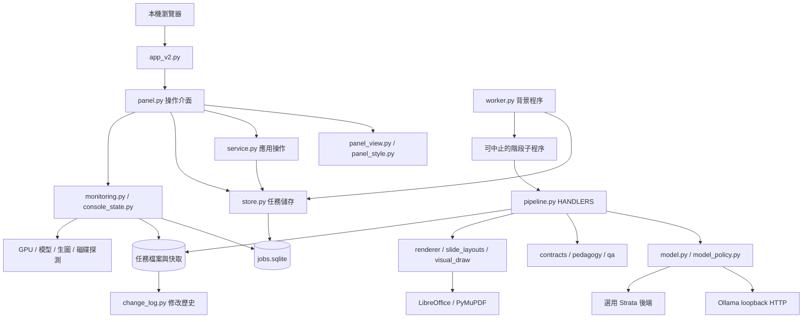
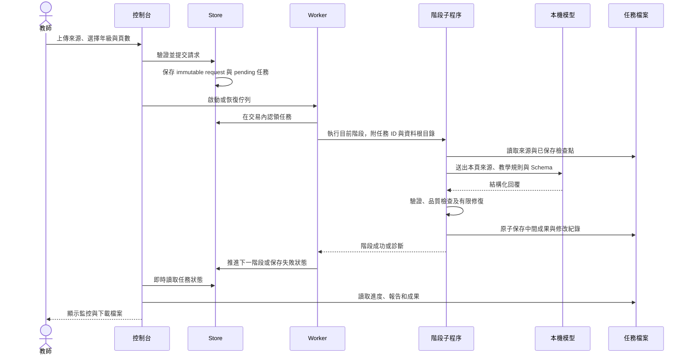
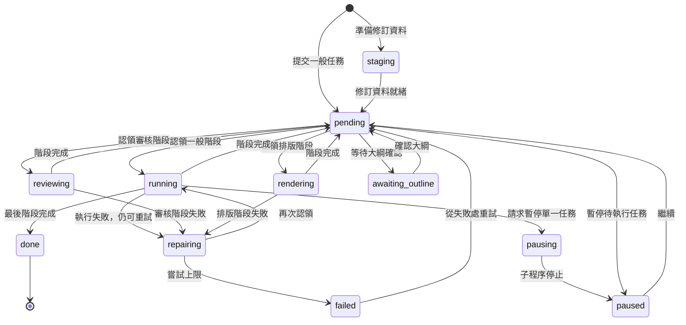

# 專案架構

適用版本：v1.0.0。本文依目前程式入口與資料流撰寫，供維護、部署及功能擴充使用。

## 1. 系統邊界

系統由 Streamlit 控制台、SQLite 任務儲存、背景 Worker、階段子程序、本機模型服務與檔案成果組成。控制台接受使用者操作並讀取狀態；長時間生成由背景程序執行，避免瀏覽器重整直接中斷工作。

預設以 Windows 原生 Python 與 Ollama 執行。模型服務、轉檔工具和生圖服務有各自的啟動與資源邊界。公開 GitHub 儲存庫保存程式和規則，本機工作資料另存於 `data/`。



本專案提供 Python 應用介面，不提供另外一套對外 REST 管理伺服器。`service.py` 的「介面」指 Python 函式；`8502` 是本機控制台。

## 2. 入口與模組分工

| 類別 | 模組 | 主要責任 |
| --- | --- | --- |
| 網頁入口 | `app_v2.py` | 設定頁面名稱、圖示與主版面，呼叫 `panel.show()` |
| 啟動與停止 | `launch_v2.py`、`shutdown.py`、`open_ui.ps1`、`close_ui.ps1` | 啟動、確認及停止屬於本系統的程序 |
| 環境準備 | `bootstrap.ps1` | 初始化設定、Python 環境、依賴及必要引擎 |
| 操作介面 | `panel.py` | 任務表單、監控操作、教材卡片、檔案與紀錄 |
| 視覺元件 | `panel_view.py`、`panel_style.py`、`job_thumb.py`、`brand.py` | HTML、主題、動畫、縮圖及品牌素材 |
| 應用服務 | `service.py` | 大綱確認、成果查詢、單頁修訂任務 |
| 任務儲存 | `store.py` | SQLite 狀態、佇列、任務目錄和原子 JSON 寫入 |
| 階段調度 | `worker.py` | 認領任務、啟動子程序、限時、完成與失敗處理 |
| 來源 | `library.py`、`source_reader.py` | 教材庫讀取、頁面文字與辨識恢復 |
| 生成管線 | `pipeline.py` | 七階段處理、快取、逐頁生成、審核及成果整合 |
| 推論 | `model.py`、`strata.py`、`model_policy.py` | 本機端點、模型選擇、JSON 回覆和重試 |
| GPU 協調 | `engine.py`、`concurrency.py` | 模型服務管理、槽位與顯存條件 |
| 教學規則 | `age_bands.py`、`curriculum_prompts.py`、`pedagogy.py` | 年級密度、教學提示與教學循環 |
| 合約 | `contracts.py`、`schemas/`、`visuals.py` | 工作、頁面、成果與圖解資料的驗證 |
| 內容檢查 | `qa.py`、`text_safety.py`、`originality.py` | 算式、題意、來源、殘留字與重複內容 |
| 簡報排版 | `renderer.py`、`template_builder.py`、`template_design.py`、`template_styles.py` | 由程式建立頁面、依年級科目配置樣式 |
| 教學圖形 | `slide_layouts.py`、`visual_draw.py`、`textfit.py`、`animations.py` | 可編輯圖解、字級與答案揭示 |
| 圖片 | `images.py`、`local_images.py`、`image_fallback.py`、`forge_boot.py` | 本機生圖、授權圖片搜尋、快取與替代 |
| 整份檢查 | `deck_check.py`、`visual_qa.py` | 匯出後內容與版面檢查 |
| 最後優化 | `final_optimizer.py`、`polish_scope.py` | 選擇需檢查頁面、文字優化與安全撤回 |
| 文件輸出 | `office.py`、`worksheet.py` | PDF、預覽、學習單與教師解答 |
| 編輯 | `page_edit.py`、`restyle.py` | 修改文字或重排既有成果，失敗時恢復備份 |
| 觀測 | `monitoring.py`、`console_state.py`、`monitor_report.py`、`health.py`、`timing.py` | 即時數據、中文狀態、服務檢查和耗時分析 |
| 紀錄 | `runlog.py`、`change_log.py` | 執行事件與完整修改差異 |
| 蒸餾 | `distill/` | 蒐集、評分、資料集、訓練、匯出、比較與採用 |

`template_*` 是建立投影片樣式與頁面結構的程式模組，並不代表系統載入外部 PPTX 模板。正式控制台使用 `panel.py`；早期的 `ui.py`、`monitor_ui.py` 與 `console_view.py` 已移除。

## 3. 一份教材的生命週期



開啟「先確認大綱再製作」時，規劃完成後進入 `awaiting_outline`，等待教師確認。確認操作先驗證修改後的大綱與教學循環，再將任務恢復為待執行。

## 4. 七階段及成果

階段順序固定於 `store.STAGES`，由 `pipeline.HANDLERS` 映射至處理函式。

| 索引 | 階段 | 處理函式 | 工作內容 | 代表性資料 |
| ---: | --- | --- | --- | --- |
| 0 | `source` | `source()` | 來源擷取、頁碼、文字恢復、長來源整理 | `source.json`、`source-summary/`、`source-ocr/` |
| 1 | `plan` | `plan()` | 教材解析、教學目標、大綱與教學循環 | `analysis.json`、`plan.json` |
| 2 | `write` | `write()` | 逐頁提示、Schema 驗證、離線 QA 和修復 | `slides/`、`page-policies/`、`qa-report.json` |
| 3 | `review` | `review()` | 模型審核、退件頁修復和結果快取 | `reviews/`、`reviewed-deck.json` |
| 4 | `render` | `rendering()` | 頁面結構、原生圖形、插圖及簡報 | `rendered-deck.json`、`教材.pptx`、`design.json` |
| 5 | `preview` | `preview_stage()` | PDF、PNG 預覽與版面 QA | `教材.pdf`、`previews/`、`visual-qa.json` |
| 6 | `publish` | `publish()` | 最後優化、備課稿、學習單與成果清單 | `final-optimized-deck.json`、`result.json`、DOCX |

檔案會依工作內容選擇性建立。例如未要求學習單時不輸出學習單；圖片、辨識與修訂資料也只在需要時保存。

## 5. 工作狀態機



`status` 和 `stage` 分開儲存。`running` 不代表整份教材從頭重做；同一任務可能在多個階段間回到 `pending`。`reviewing` 與 `rendering` 是不同階段的執行顯示。完成全部七階段後，`stage` 為 7、`status` 為 `done`。

移除另使用 `removing` 避免任務被再次認領，停止相關工作後將資料移到回收區並移除活動目錄中的資料庫項目。

## 6. SQLite 資料模型

資料庫位於 `data/workflow-v2/jobs.sqlite`。連線由 `Store.db()` 管理，以交易提交並在結束後關閉連線，啟用 WAL。

| 資料表 | 欄位 | 用途 |
| --- | --- | --- |
| `jobs` | `id`、`request`、`status`、`stage`、`attempts`、`error`、`created`、`updated` | 任務身分、保存請求、檢查點與錯誤 |
| `events` | `id`、`job`、`stage`、`message`、`created` | 階段開始、完成及其他任務事件 |
| `queue_state` | `key`、`value` | 佇列目前任務等狀態 |

`request` 是 JSON 文字，保存年級、科目、學期、單元、來源、頁數、模型與選項。工作 ID 是 32 字元十六進位識別碼；任務路徑只接受符合格式的 ID。

認領使用 `BEGIN IMMEDIATE`，並檢查是否已有執行中工作。一般情況下每次只處理一份教材；單份教材的頁面並行則由另一組資源規則決定。

## 7. 檔案資料模型

```text
data/workflow-v2/
├─ jobs.sqlite
├─ ui-prefs.json
├─ session-start.json
├─ worker.lock / worker.pid / pause
├─ cache/
├─ uploads/
├─ deck-changes/
│  └─ YYYY-MM.jsonl
├─ history/
├─ trash/
└─ jobs/<id>/
   ├─ source.json / analysis.json / plan.json
   ├─ teaching-profile.json / teaching-prompt.md
   ├─ slides/001.json ...
   ├─ calls/ / reviews/ / page-policies/
   ├─ source-summary/ / source-ocr/
   ├─ qa-report.json / quality-warnings.json
   ├─ design.json / visual-assets.json / image-sources.json
   ├─ 教材.pptx / 教材.pdf / previews/
   ├─ 教師備課稿.docx
   ├─ 學生學習單.docx / 學習單教師解答.docx
   ├─ final-optimization.json / deck-validation.json / visual-qa.json
   ├─ result.json
   └─ run.jsonl / changes.jsonl / 各階段.log
```

網頁上傳原檔由表單保存至 `Store.DATA/uploads/`。來源摘要、已生成頁面和原始模型回覆有各自的檔案，不能只把 `教材.pptx` 視為完整的續作資料。

`result.json` 是發布成果索引，包含輸出檔案位置與品質、圖片、學習單等狀態。前端下載來源由這份索引及檔案存在性確認，而不是憑任務名稱猜路徑。

## 8. 合約與模型輸出

`contracts.py` 定義工作、大綱、投影片與相關資料的 Schema。投影片內容使用受控的 `layout_id`、標題、內文、圖片描述、教師備註與來源頁碼；版面座標由排版程式決定。

| 合約 | 主要限制 |
| --- | --- |
| 工作 | 年級 4～9、三個科目、8～50 頁、繁體中文 locale、固定難度選項 |
| 大綱 | 學習目標、頁面主題、教學階段、難度、引用頁碼與教學任務 |
| 投影片 | 已知版型、對應資料欄位、引用範圍與內容驗證 |
| 視覺模型 | 可支援的圖解類型、數值關係與結構 |
| 成果 | 發布索引與可下載檔案 |

模型回覆經解析、正規化和驗證後才寫入正式頁面。未通過時帶具體問題重試；完整回覆只缺 JSON 結尾括號時可嘗試修復，真正截斷的內容不直接當作完整答案。

系統使用模型輸出的資料，不執行模型提供的程式碼或座標。

## 9. 模型政策與資源控制

`model_policy.bind()` 在固定模式下將外部工作請求中的模型欄位對應到管理員設定。文字模型由 `preferred_model` 或可選的 `distilled_model` 指定；影像請求保留使用基礎模型的路徑。

Ollama 預設使用 `127.0.0.1:11435`，專案管理的模型檔位於 `models/ollama/`。模型端點只接受本機 HTTP，禁止含帳密、查詢參數或路徑的端點設定。Strata 的端點也有本機限制。

`concurrency.py` 依設定、服務槽位與可用顯存決定並行度。預設 `ollama_parallel: 1`、`write_concurrency: 1`；記憶體不足時回退並保存決策。總結頁需等待前頁內容，不能與仍未完成的前頁任意並行。

本機生圖會協調顯存，圖形化數學內容仍由原生形狀表示；服務失敗時按來源與圖解規則尋找替代，而不是填入任意圖片。

## 10. 鎖、原子寫入與恢復

| 機制 | 解決的問題 |
| --- | --- |
| SQLite 認領交易 | 多個程序同時認領不同教材或同一任務 |
| Worker lifetime lock | 重複啟動背景調度器 |
| 模型 GPU 槽位鎖 | 同時推論造成資源衝突 |
| LibreOffice 轉檔鎖 | 共用轉檔環境與多程序衝突 |
| 修改紀錄檔案鎖 | 多個修改事件交錯寫入 JSONL |
| 暫存 JSON + `os.replace` | 讀到寫一半的檢查點 |
| 階段子程序與逾時 | 模型、轉檔或外部服務長時間無回應 |

`store.atomic()` 先寫入同目錄暫存檔，再替換正式檔；Windows 暫時鎖住檔案時有有限重試。修改紀錄的失敗不會把已成功保存的成果變成失敗任務。

Worker 啟動時回收已中斷狀態。階段處理會驗證已有頁面、大綱、來源指紋與教學規則，決定哪些資料可以重用；主教材改變時，先保存歷史資料再重新開始來源處理。

## 11. 三種停止語意

1. **暫停佇列**：寫入 `pause` 標記。目前階段完成後，不再啟動下一階段。
2. **暫停單一任務**：將執行中任務轉為 `pausing`，中止階段程序後保存為 `paused`；待執行任務可直接暫停。
3. **停止生成服務**：停止經程序資訊確認屬於專案的工作與模型服務，保留控制台，供查詢與之後恢復。

關閉整個介面由啟動／停止腳本處理。操作流程需要檢查程序所有權，不能只按連接埠或名稱結束其他應用。

## 12. 快取與修訂

來源摘要、文字辨識、頁面政策、審核與圖片各自保存快取。快取判定包含來源、內容或相關規則指紋；重試不應無條件接受一份雖存在但已失效的 JSON。

單頁重新生成由 `service.regenerate()` 建立新任務，複製可重用的來源、大綱和其他頁面，清除目標頁的政策與 QA 結果，再從編寫階段開始。`regenerate.json` 保存父任務、頁碼、指定欄位與指示，`regenerate-original.json` 保存目標頁原稿。

人工文字編輯由 `page_edit.save_page()` 操作既有文字框，重新匯出預覽與發布檔；重新排版由 `restyle.py` 重用既有內容。兩者皆有備份與失敗恢復機制。

## 13. 監控與動畫

`monitoring.snapshot()` 彙整工作、GPU、詞元、報告與服務資料。`console_state.py` 將資料轉為狀態、目前頁面、完成度、事件與操作提示。`panel_view.py` 只負責 HTML，動態文字輸出前跳脫。

| 數據 | 計算方式 |
| --- | --- |
| 完成度 | 階段權重加目前階段的已完成比例；活動任務上限為 99% |
| T+ | 事件記錄中的執行區間累計；目前執行區間持續增加 |
| 卡片製作總時長 | 同一組事件區間累計；已完成任務停止累加 |
| 預估剩餘 | 根據完成度與已有耗時估算；證據不足時顯示估算中 |
| 詞元 | 保存的模型回覆中的使用量欄位；修訂避免重複計算複製的回覆 |
| GPU | `nvidia-smi` 探測；缺失時顯示無資料 |

監控使用 Streamlit fragment 定時更新，預設每秒更新監控區，教材列表另有刷新節奏。主題樣式與控制項不需要隨每次數據更新重建。

數字、儀表與進度使用 600 ms 過渡；目前節點只讓內圈輕柔變化，外圈和連線保持清楚。狀態脈動與進度光帶在活動狀態啟用，系統或介面的「減少動畫」可將其關閉。

## 14. 執行紀錄與修改歷史

`runlog.py` 保存服務與工作事件。運行 log 有大小控制，主要用於診斷；模型原始回覆另外保存在任務檔案。

`change_log.py` 保存修改事件，使用 `ContextVar` 帶入操作者、階段和原因。`store.atomic()` 的前後讀取鉤子只追蹤指定教材檔案，不把每次進度刷新都當成修改。

修改事件包括唯一 ID、UTC 時間、任務與修訂關係、模型與規則指紋、前後 SHA-256、完整前後內容及 JSON Pointer 差異。同一事件寫入月份檔與單份任務檔；相同內容不重複記錄。

月檔位於 `deck-changes/YYYY-MM.jsonl`，不受「清除運行紀錄」操作影響。詳細格式見 [簡報修改紀錄](簡報修改記錄.md)。

## 15. 蒸餾流程與隔離


蒸餾資料保存在 `data/distill/`，使用另一個工作儲存區與訓練環境。評分重用正式生成流程的規則，訓練集與比較單元分開；是否採用新模型依比較結果決定。這套流程不是預設啟動控制台所需步驟。

## 16. 測試與擴充

測試使用暫存資料、mock 服務與既有回歸案例，涵蓋 Schema、內容品質、重試與恢復、圖片替代、編輯、修改紀錄、配色與正式網頁入口。發布前完整基準為 534 項；實際 GPU、模型、轉檔與新主機安裝另外驗證。

新增功能應先找對層級：

- 新增表單選項：同時更新 `panel.py`、`contracts.REQUEST` 與讀取該選項的管線。
- 新增投影片內容結構：更新 Schema、正規化、品質規則與排版函式。
- 新增模型後端：保留模型政策、端點限制、結構化回覆和錯誤處理邊界。
- 新增監控數字：在資料層計算，HTML 只格式化；缺資料時保留未知狀態。
- 新增修改動作：帶入明確操作者、任務、頁碼與原因，沿用修改紀錄機制。
- 修改並行或逾時：保留中止、恢復與有限嘗試，驗證小顯存和服務失敗的回退。

## 17. 交付邊界

v1.0.0 是本機應用和原始碼發布。它不包含教材庫、模型權重、雲端推論服務、多租戶登入、跨主機客服 App 串接或公開網路部署。安裝包與 GitHub 原始碼各有用途：前者交付操作程式，後者另包含完整測試和開發文件。
